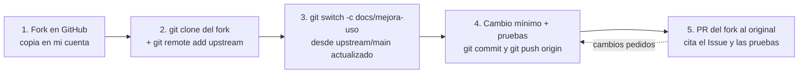

# Contribución a proyectos públicos (Capítulo 16)

> Todo lo que implicaría escribir en repositorios de terceros (comentar, hacer fork, abrir PR) se **simuló localmente**. En GitHub solo se leyó información pública.

## 16.1 · Reglas de contribución de un proyecto público: `cli/cli`
Fuente: `.github/CONTRIBUTING.md` de https://github.com/cli/cli (versión `d6cbbe9`, 08/09/2026).

| Tema | Regla de `cli/cli` | Adaptación a Andina Market 360 |
|---|---|---|
| Comunicación previa | Buscar si el Issue ya existe; abrir un Issue para proponer cambios | Todo cambio de código parte de un Issue con criterios de aceptación |
| Qué se acepta | PR externos solo para Issues `help wanted` con *Acceptance Criteria* explícitos | PR solo para Issues con criterios; si faltan, se piden en el Issue |
| Alcance | No ampliar el PR más allá de los criterios del Issue | Un PR por tema; lo demás va a otro Issue (como la sugerencia de % en #8) |
| Ramas | `git checkout -b my-branch-name` | Prefijos `feature/`, `fix/`, `docs/`, `laboratorio/` |
| Pruebas | “add tests, and ensure tests pass” (`go test ./...`) | `python -m unittest discover -s tests -v` en OK y prueba nueva para cada corrección |
| Licencia | Las contribuciones se publican bajo la licencia del proyecto | Las contribuciones se publican bajo MIT (ver `LICENSE`) |
| Conducta | Código de conducta | Trato respetuoso: se comenta el cambio, no a la persona |

La adaptación no promete permisos que `cli/cli` no concede: solo copia **prácticas** y las aplica a un repositorio propio.

## 16.2 · Propuesta previa al cambio (borrador, no publicado)
**Issue elegido:** [cli/cli#9789](https://github.com/cli/cli/issues/9789), “`gh auth login --with-token` hangs”. Etiquetas: `bug`, `priority-3`, `help wanted`, `gh-auth`. Sin asignar.
**Estado leído:** `cli/cli` no tiene ningún Issue abierto con `good first issue`; este tiene `help wanted`. El equipo mantenedor aceptó los criterios de aceptación propuestos (05/10/2026), y el último comentario (06/11/2026) pregunta si sigue en revisión. **No se asume que esté disponible**: primero habría que preguntar en el hilo, una sola vez.

> **Borrador de propuesta**
> Alcance: cuando se ejecuta `gh auth login --with-token` sin redirigir la entrada estándar (terminal interactiva), mostrar un aviso que explique que se espera el token por stdin y cómo pasarlo, en lugar de quedar esperando sin mensaje.
> Prueba esperada: prueba unitaria del comando con stdin simulado como TTY que verifique el aviso y el código de salida; prueba existente con token redirigido sin cambios.
> Fuera de alcance: otros flujos de `auth login`.

## 16.3-16.4 · Fork, upstream y contribución mínima (simulación local)
Repositorios locales descartables: `upstream-publico.git` (el original), `fork-estudiante.git` (copia completa con su historia, como hace *Fork*) y la carpeta de trabajo `trabajo/`.
- `origin` → el fork propio; `upstream` → el original, agregado con `git remote add upstream` **sin reemplazar** `origin`.
- Rama `docs/mejora-uso`: la instrucción `python reporte.py` fallaba (el script está en `src/`); se corrigió a `python src/reporte.py` y se verificó ejecutándola. Diff: 1 línea.

## 16.5 · PR de muestra (texto preparado, no enviado)
> **Título:** docs: corregir la ruta del script en el README
> **Issue:** #12 (*ejemplo*: “La instrucción de uso no funciona”).
> **Cambio:** `README.md`, paso 2: `python reporte.py` → `python src/reporte.py` desde la raíz del proyecto.
> **Motivación:** con la instrucción actual, Python responde *can't open file … reporte.py*; quien llega por primera vez no puede ejecutar el ejemplo.
> **Pruebas:** ejecuté la instrucción corregida (`inventario`); la guía pide `python -m unittest` y lo ejecuté sin errores. No cambia código.
> **Reconocimiento:** gracias a quienes mantienen la guía inicial; el cambio respeta la licencia MIT del proyecto y no agrega material de terceros.
> Quedo atento a cualquier ajuste; si prefieren otra redacción, la cambio en esta misma rama.

**Ajuste pedido por la persona mantenedora (simulado):** “indique también `python3` para Linux” → segundo commit en la **misma** rama (`docs: indicar el comando python3 para Linux`), sin abrir otro PR.

## Reto 16.1 · Propuesta de mejora documental para un proyecto público con reglas claras
**Proyecto:** `cli/cli` (reglas explícitas en `CONTRIBUTING.md`).
**Hallazgos verificables** en `.github/CONTRIBUTING.md` (`d6cbbe9`):
1. Línea 57: “propose a design to solve an **open** bug…”, pero el enlace de referencia (línea 79) filtra `state%3Aclosed`, es decir, muestra Issues **cerrados**.
2. Línea 57 nombra la etiqueta `help-wanted` (con guion), mientras que la etiqueta real y la que usa el resto del documento es `help wanted` (con espacio).

**Propuesta (borrador):** cambiar `state%3Aclosed` por `state%3Aopen` en el enlace y escribir `help wanted` en la línea 57.
**Cómo se haría respetando sus reglas:** como su guía pide abrir un Issue antes de cambiar documentación, primero se abriría un Issue con estos dos hallazgos y se esperaría su respuesta. No se envió nada; queda como propuesta.

## Reto 16.2 · Flujo fork → rama → commit → PR en cinco pasos

## Reto 16.3 · Tres responsabilidades éticas de quien contribuye a código de terceros
1. **Respetar las reglas y el tiempo del proyecto:** leer `CONTRIBUTING.md`, no abrir PR que la guía no acepta (por ejemplo, sin `help wanted` en `cli/cli`), no repetir comentarios para presionar y aceptar un “no”.
2. **Honestidad sobre autoría y licencias:** no copiar código con licencia incompatible, reconocer el trabajo previo y declarar si se usó ayuda de herramientas cuando el proyecto lo pida.
3. **No dañar a usuarios ni al proyecto:** no incluir datos personales, secretos ni cambios ocultos fuera del alcance; reportar las vulnerabilidades por el canal privado indicado (`SECURITY.md`), no en un Issue público.
