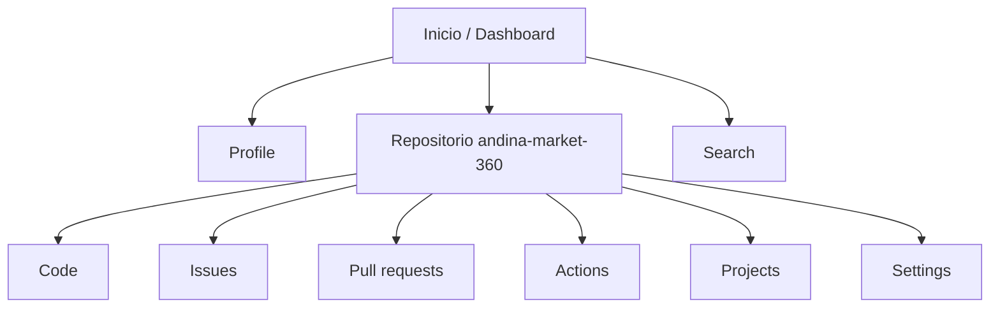

# Mapa de navegación de GitHub (Reto 3.1)

| # | Sección | Ruta en `andina-market-360` | Utilidad en el caso |
|---|---|---|---|
| 1 | Code | https://github.com/maxigva/andina-market-360 | Leer README, CSV, script y pruebas |
| 2 | Issues | https://github.com/maxigva/andina-market-360/issues | Registrar tareas y errores del resumen |
| 3 | Pull requests | https://github.com/maxigva/andina-market-360/pulls | Revisar cambios antes de fusionarlos a `main` |
| 4 | Actions | https://github.com/maxigva/andina-market-360/actions | Ver si las pruebas pasan en cada push |
| 5 | Projects | https://github.com/maxigva/andina-market-360/projects | Tablero de tareas por capítulo |
| 6 | Settings | https://github.com/maxigva/andina-market-360/settings | Visibilidad, ramas protegidas y Pages |

Las URL se obtuvieron con `gh browse -n` (imprime la dirección sin abrir el navegador). GitHub renderiza el bloque `mermaid` como diagrama.
